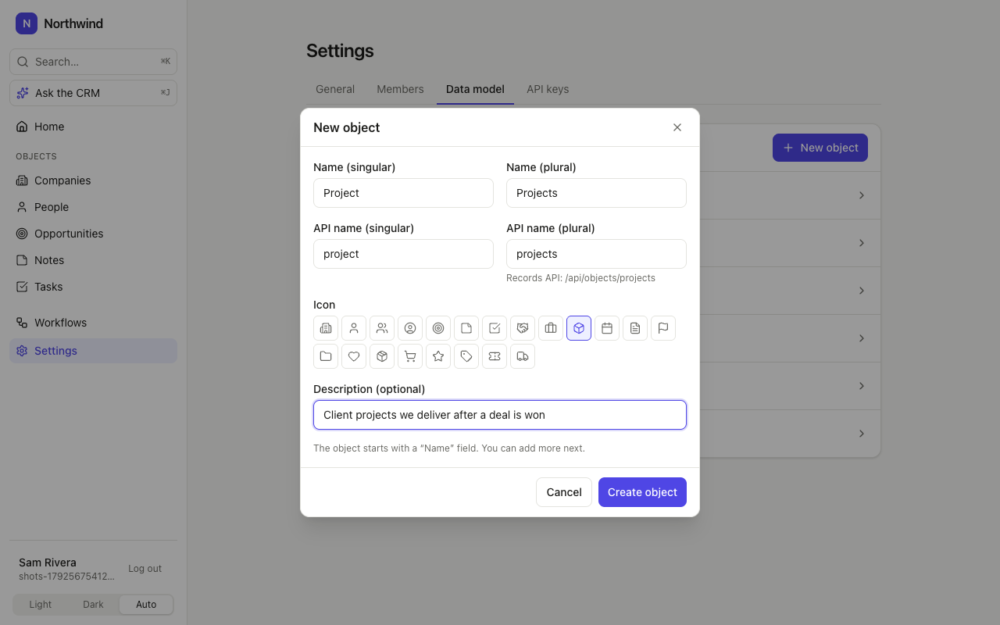
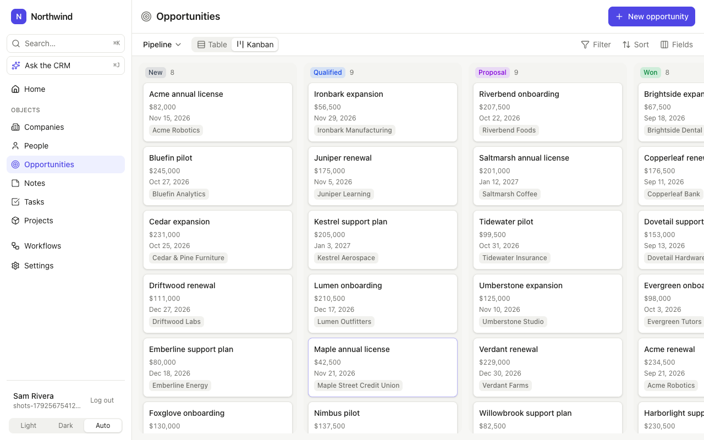
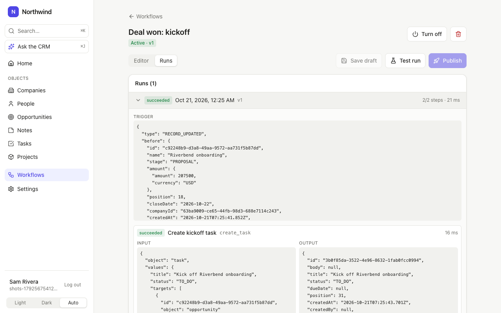
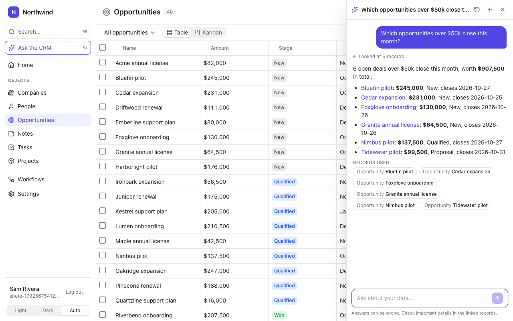
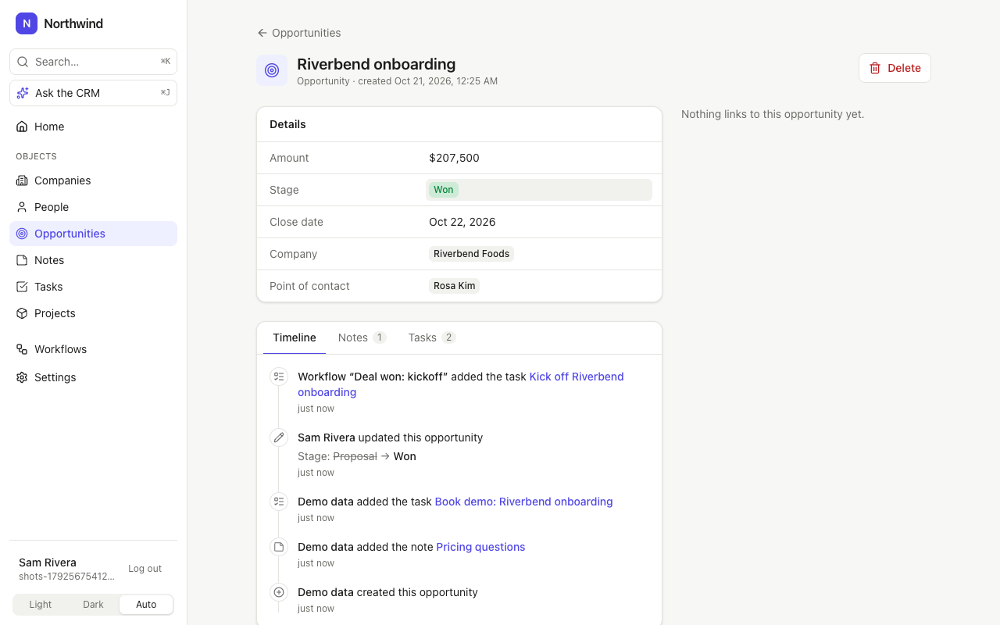
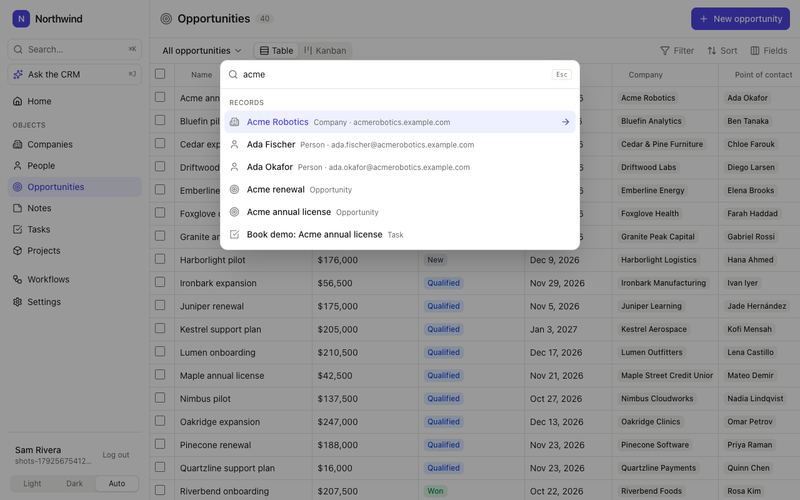
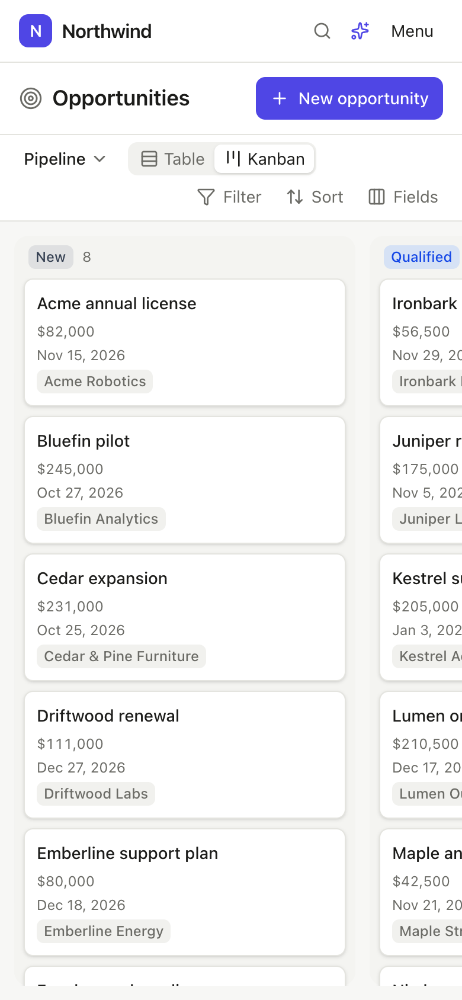
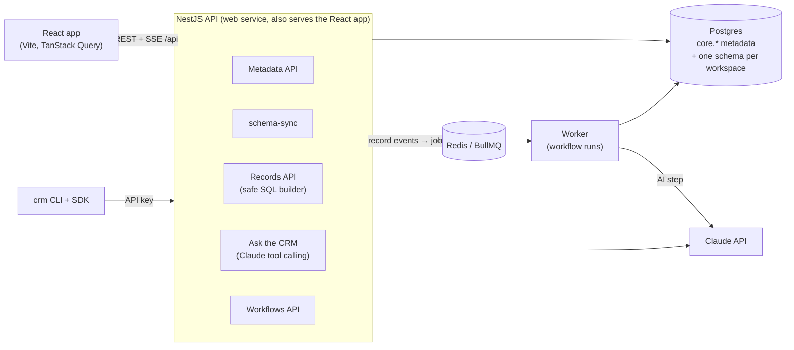

# CRM Replica

**A CRM whose data model is yours to change.** Add custom objects and fields in the browser or
as code, view them as tables or kanban boards, automate them with workflows, and ask an AI
assistant about them.

**Live demo:** _coming soon_ · demo login `demo@example.com` / `try-the-demo` (shown on the
login page; the demo workspace is rebuilt every night)

> Inspired by [Twenty](https://github.com/twentyhq/twenty) (twentyhq/twenty). Independent
> implementation; no Twenty code used.

| Create a custom object                                        | Kanban view                                                                                    |
| ------------------------------------------------------------- | ---------------------------------------------------------------------------------------------- |
|            |                                                      |
| **A workflow run**                                            | **Ask the CRM**                                                                                |
|   |  |
| **Record timeline**                                           | **⌘K search**                                                                                  |
|  |                                             |



## What it does

- **Metadata-driven data model.** Objects and fields are data. Creating an object creates a real
  Postgres table; adding a field adds a column. 13 field types: text, number, currency, checkbox,
  date, date-time, select, multi-select, email, phone, link, rating, relation (with the reverse
  side shown on the other object). Companies, People, Opportunities, Notes and Tasks come built
  in; you can add fields to them and create your own objects in **Settings → Data model**.
- **Records API for every object**, generated from the data model: filter trees (`and` / `or` /
  `not`, operators per field type), multi-field sort, cursor pagination, `?expand=` relations,
  and OpenAPI docs at `/api/docs` that always match your current objects.
- **Tables and kanban.** Inline editing per field type, resizable / reorderable columns, infinite
  scroll, bulk delete, saved views with filters and sorts, kanban boards with drag and drop.
- **Record pages** with every field, related records, notes, tasks and a **timeline** of who
  changed what (people, API keys, workflows and the assistant).
- **Objects as code.** `defineObject` / `defineView` / `defineWorkflow` in TypeScript, and a `crm`
  CLI that diffs and pushes them like a database migration.
- **Workflows.** Triggers (record created / updated / deleted, manual button, cron schedule) and
  steps (create / update / find records, send email, HTTP request, wait, if / else, **AI step**)
  with `{{variables}}`. Runs execute in a background worker with retries, versions and a run
  history showing each step's input, output and errors.
- **Ask the CRM** (⌘J). A Claude-powered assistant with tools generated from your data model.
  It reads as you, links to the records it used, and **asks before changing anything**.
- **⌘K command palette**, a home feed of recent activity and your open tasks, light and dark
  themes, and a layout that works on phones.
- **Workspaces** with admin / member roles, invite links, API keys and rate limits.

## Architecture



- **One Docker image, two processes:** `node apps/server/dist/main.js` (API + web app on one
  URL, no CORS) and `node apps/worker/dist/main.js` (BullMQ worker). The worker is built from
  the server's own modules, so both run the same records and workflow code.
- **Postgres** holds the metadata (`core.*`) and each workspace's records in its own schema
  (`workspace_<id>`). **Redis** carries the job queues and rate-limit counters.

## Objects as code

Define objects, fields, views and workflows in TypeScript and sync them like a migration.

```ts
// examples/sales-app/objects/deal.ts
import { defineObject, FieldType } from '@crm-replica/sdk';

export default defineObject({
  nameSingular: 'deal',
  namePlural: 'deals',
  labelSingular: 'Deal',
  labelPlural: 'Deals',
  fields: [
    { name: 'name', label: 'Name', type: FieldType.TEXT },
    { name: 'amount', label: 'Amount', type: FieldType.CURRENCY },
    {
      name: 'stage',
      label: 'Stage',
      type: FieldType.SELECT,
      options: ['Lead', 'Negotiation', 'Won', 'Lost'],
    },
    { name: 'closeDate', label: 'Close Date', type: FieldType.DATE_TIME },
  ],
});
```

```console
$ crm diff
App sales-app → workspace Northwind at http://localhost:3000

  + Create object deal (Deals) with 4 fields
      + name (TEXT)
      + amount (CURRENCY)
      + stage (SELECT)
      + closeDate (DATE_TIME)
  + Add field deal.company (Relation → company)
  + Create table view "Big deals" on deal
  + Create kanban view "Deal pipeline" on deal
  + Create and publish workflow "Opportunity won: kickoff" (2 steps)

5 to create, 0 to update, 0 to remove

$ crm push --yes
✓ Applied 5 change(s) to the workspace.

$ crm diff
No changes. The workspace already matches the app.
```

- `crm init` scaffolds an app, `crm validate` checks definitions, `crm diff` previews the plan,
  `crm push` applies it in **one transaction** (all or nothing), `crm pull` writes the workspace
  back to code.
- Changes that delete data (removing a field or object, changing a field's type) are refused
  unless you pass `--allow-destructive`.
- A push only removes what that app created; objects and fields made in the UI are never
  deleted by code.
- Authenticate with an API key from **Settings → API keys** (`CRM_API_KEY` or the app's `.env`).

See [examples/sales-app](examples/sales-app) to try it.

## Design decisions

**Metadata-driven schema, real tables.** Objects and fields live in `core.object_metadata` and
`core.field_metadata`; schema-sync turns them into real tables and columns (`CREATE TABLE`,
`ALTER TABLE ADD COLUMN`, foreign keys for relations) inside the same transaction as the
metadata change. Records are therefore ordinary rows: Postgres types, indexes, constraints and
joins all work, and there's no entity-attribute-value table to query around.

**One Postgres schema per workspace.** Each workspace's tables live in `workspace_<id>`, which
gives tenant isolation at the database level, lets two workspaces have different data models,
and makes deleting a workspace a single `DROP SCHEMA`.

**Safe dynamic SQL.** Table and column names come only from metadata and pass an identifier
whitelist before being quoted; values are always bound parameters with explicit casts. Filters
arrive as a JSON tree that is validated against the field's type and allowed operators, so
user input never becomes SQL text. The filter builder has tests for injection attempts.

**Event-driven workflows on BullMQ.** Every record change emits an event after it commits. A
listener matches published workflows and queues a run; the worker executes it step by step,
saving progress after each step so retries (exponential backoff) and delays resume where they
stopped. Runs point at the workflow version they started with, and a depth counter on events
stops a workflow that keeps re-triggering itself.

**A tool-calling agent that asks before it writes.** Ask the CRM's tools (`list_objects`,
`describe_object`, `search_records`, `get_record`, `create_record`, `update_record`) are
generated from the workspace's data model and run through the same records service as the
API, as the signed-in user. Reads run immediately; writes are validated, shown to the user as
before → after cards, and only run after **Approve**. Answers stream over Server-Sent Events and
link to the records the agent used.

**History for everything.** The timeline is written from the same record events, in the API
and the worker, so changes made by people, API keys, workflows and the assistant all show up,
each labelled with who or what made them.

## Local setup (macOS)

Requirements: Node 22+ (24 recommended), pnpm 11, Docker Desktop.

```bash
cp .env.example .env        # defaults match docker-compose.yml
pnpm install
docker compose up -d        # Postgres on :5432, Redis on :6379
pnpm dev                    # API :3000, web :5173, worker, all with live reload
```

Open http://localhost:5173, click **Create a workspace**, then **Add demo data** on the home page
for 30 companies, 60 people and 40 opportunities with notes and tasks. The API runs database
migrations on start.

For the AI features, put an Anthropic API key in `.env` (`ANTHROPIC_API_KEY=sk-ant-…`) and
restart `pnpm dev`. Requests use `claude-opus-5-5` by default (`ANTHROPIC_MODEL`) with
server-side refusal fallbacks: if the model declines, the API retries on Anthropic's
recommended fallback model in the same call.

Run everything in Docker instead (production-like, one URL on :3000):

```bash
docker compose --profile full up --build
```

## Tests

```bash
pnpm test        # everything (server e2e tests need `docker compose up -d`)
```

About 490 tests: unit tests (filter builder incl. SQL-injection attempts, value codec, sort
cursors, workflow validator, demo data), server end-to-end tests against a real Postgres and
Redis (schema-sync for every field type, records API, views, objects-as-code apply, workflow
runs through a real BullMQ worker with retries and delays, the agent's tool loop and approval
flow with a scripted model, timeline, search, rate limits, demo mode), web component tests
(Vitest + Testing Library) and CLI tests. Tests never call the real Claude API.

CI (`.github/workflows/ci.yml`) runs lint, format check, typecheck, tests (with Postgres and
Redis service containers) and build, and checks that the Docker image builds.

| Command          | Does                                                       |
| ---------------- | ---------------------------------------------------------- |
| `pnpm dev`       | Builds dependencies once, then runs all apps in watch mode |
| `pnpm test`      | All tests                                                  |
| `pnpm lint`      | ESLint                                                     |
| `pnpm typecheck` | TypeScript in every package                                |
| `pnpm build`     | Production build of every package                          |
| `pnpm format`    | Prettier                                                   |

## Deployment

Railway runs it as two services from one image plus Postgres and Redis. Step by step:
**[docs/deploy-railway.md](docs/deploy-railway.md)** (`railway/web.json` and
`railway/worker.json` hold each service's start command).

| Variable                                   | What it's for                                                          |
| ------------------------------------------ | ---------------------------------------------------------------------- |
| `DATABASE_URL`, `REDIS_URL`                | Postgres and Redis                                                     |
| `JWT_SECRET`                               | Signs session cookies (required in production, 32+ characters)         |
| `APP_URL`                                  | The public address (invite links; secure cookies when it's `https://`) |
| `ANTHROPIC_API_KEY`, `ANTHROPIC_MODEL`     | Ask the CRM and the workflow AI step                                   |
| `DEMO_MODE`, `DEMO_EMAIL`, `DEMO_PASSWORD` | Public demo workspace with its login on the login page                 |
| `DEMO_RESET_CRON`                          | When the demo is rebuilt (default `0 3 * * *`, UTC)                    |
| `AUTH_RATE_LIMIT`, `API_RATE_LIMIT`        | Requests per minute: sign-up / login per IP, everything else per user  |
| `AGENT_RATE_LIMIT`, `AGENT_DAILY_LIMIT`    | Assistant questions per user per minute and per day                    |
| `RESEND_API_KEY`, `EMAIL_FROM`             | Send workflow emails (otherwise they're logged)                        |

See [.env.example](.env.example) for all of them with defaults.

## What's in the repo

| Path                 | What it is                                                                   |
| -------------------- | ---------------------------------------------------------------------------- |
| `apps/server`        | NestJS API (`/api`), OpenAPI docs at `/api/docs`, serves the web app in prod |
| `apps/worker`        | BullMQ worker process; reuses the server's compiled modules                  |
| `apps/web`           | React 18 + Vite + Tailwind + TanStack Query                                  |
| `packages/shared`    | Types, schemas and constants shared by everything                            |
| `packages/sdk`       | `defineObject` / `defineField` / `defineView` / `defineWorkflow`             |
| `packages/cli`       | The `crm` command: `init`, `validate`, `diff`, `push`, `pull`                |
| `examples/sales-app` | A Deal object, a kanban and a table view, and a workflow, defined as code    |
| `docs`               | Deployment guide and screenshots                                             |

The project was built in 12 phases from [TWENTY_SPEC.md](TWENTY_SPEC.md).

## Credit

Inspired by Twenty (twentyhq/twenty). Independent implementation; no Twenty code used.
